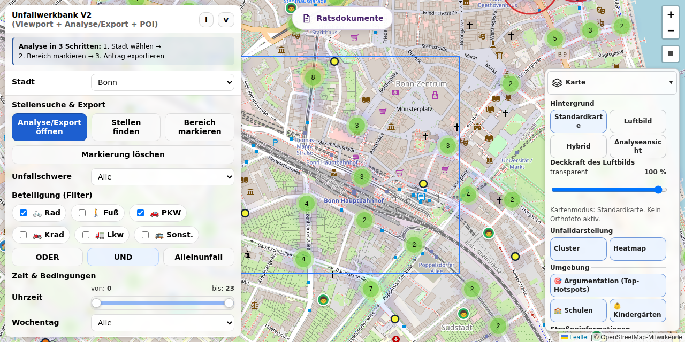
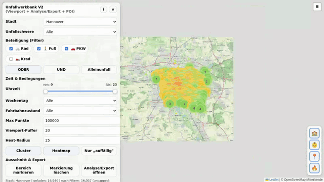
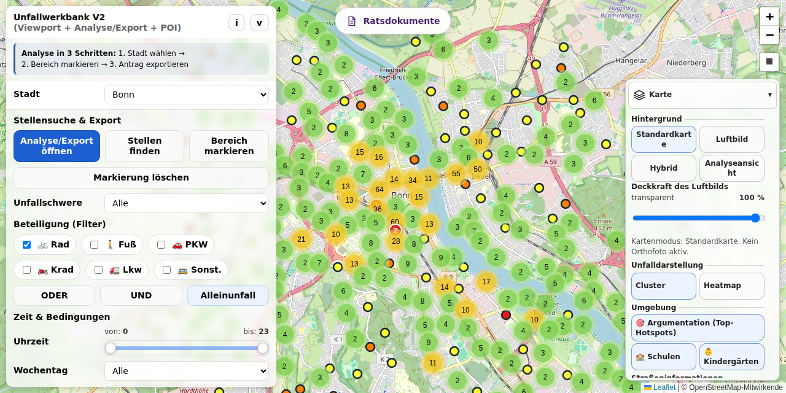
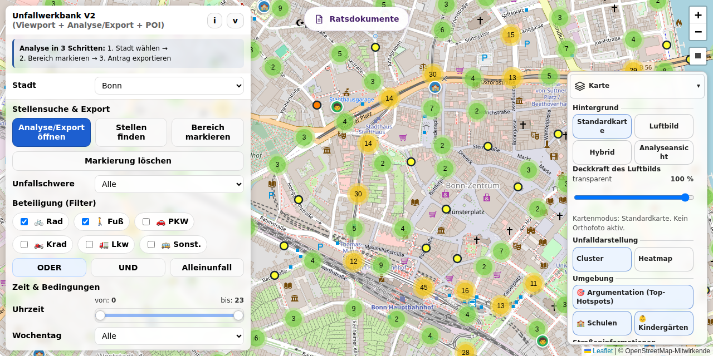
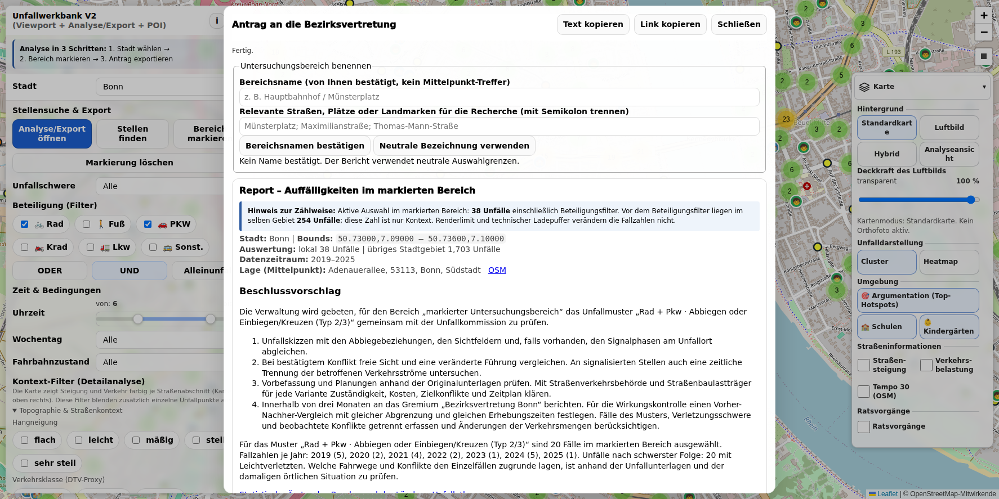
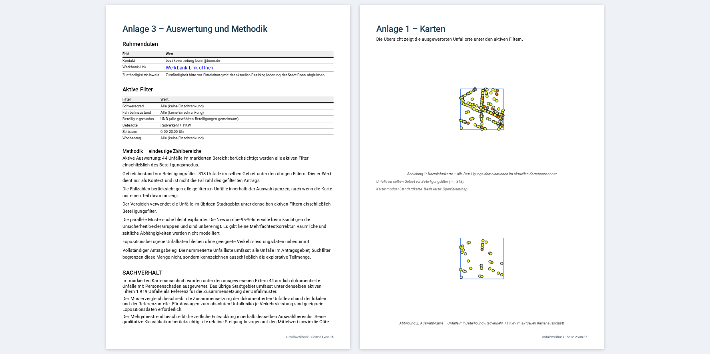

# Unfallwerkbank – Verkehrsunfälle räumlich untersuchen und nachvollziehbar teilen

> **Wo häufen sich Unfälle? Welche Beteiligten sind betroffen? Liegen auffällige Stellen an Schulen, Kitas oder bestimmten Straßenabschnitten?**
>
> Die Unfallwerkbank verknüpft amtliche Unfallorte mit Straßenmerkmalen, Verkehrszählungen, Luftbildern und kommunalen Ratsvorgängen. Eine Analyse lässt sich direkt im Browser öffnen, als reproduzierbarer Link weitergeben und als Daten- oder Dokumentexport sichern.

**[Werkbank öffnen](https://carstenartur.github.io/Unfallatlas/werkbank_v2.html?city=Hannover&severity=all&dayType=all&roadCondition=all&hourFrom=0&hourTo=23&maxPoints=100000&viewportPaddingPct=20&heatRadius=25&includeCyclist=1&includePedestrian=1&includeCar=1&includeMotorcycle=0&includeGkfz=0&includeSonstig=0&involvementMode=or&showCluster=1&showHeatmap=0&showOnlyAboveAverage=0&showSchools=1&showKindergartens=1&showArgumentation=1&mapMode=standard&orthophotoOpacity=92&centerLat=52.3759&centerLon=9.7320&zoom=12)** ·
**[Nutzungsanleitung](docs/DOKUMENTATION.md)** ·
**[Praxisbeispiele](docs/DOKUMENTATION.md#praxisbeispiele)** ·
**[Datenstatus](https://carstenartur.github.io/Unfallatlas/data-status/)**

*Klick auf einen Screenshot öffnet die gezeigte Stadt, den Kartenausschnitt und die zugehörigen Filter in der Werkbank.*

---

## Wofür ist die Unfallwerkbank gedacht?

Die Werkbank unterstützt die Vorbereitung und Diskussion konkreter Fragen zur kommunalen Verkehrssicherheit:

- Unfallhäufungen in einer Stadt oder einem markierten Bereich erkennen,
- Beteiligungskombinationen wie **Rad + Pkw** oder **Fahrrad-Alleinunfälle** untersuchen,
- Tageszeit, Wochentag, Unfallschwere und Fahrbahnzustand filtern,
- Schulen, Kitas und verfügbare Straßen- oder Geländekontexte einbeziehen,
- eine Analyse per URL teilen oder als CSV, GeoJSON, KML, Word beziehungsweise PDF exportieren.

Sie richtet sich unter anderem an Kommunalpolitik, Verkehrsplanung, Verwaltungen, Verbände, Initiativen, Forschung und Journalismus. Die Werkbank liefert eine **Analyse- und Argumentationshilfe**, aber keinen automatischen Kausalitätsnachweis und keine fertige verkehrsrechtliche Bewertung.

## In drei Minuten zur ersten Analyse

1. **[Öffentliche Browser-Version öffnen](https://carstenartur.github.io/Unfallatlas/werkbank_v2.html?city=Hannover&severity=all&dayType=all&roadCondition=all&hourFrom=0&hourTo=23&maxPoints=100000&viewportPaddingPct=20&heatRadius=25&includeCyclist=1&includePedestrian=1&includeCar=1&includeMotorcycle=0&includeGkfz=0&includeSonstig=0&involvementMode=or&showCluster=1&showHeatmap=0&showOnlyAboveAverage=0&showSchools=1&showKindergartens=1&showArgumentation=1&mapMode=standard&orthophotoOpacity=92&centerLat=52.3759&centerLon=9.7320&zoom=12).**
2. Links eine Stadt wählen und die gewünschten Beteiligten aktivieren.
3. **ODER**, **UND** oder **Alleinunfall** passend zur Fragestellung einstellen.
4. Karte verschieben oder mit **Bereich markieren** einen Ausschnitt festlegen.
5. Zwischen Cluster, Heatmap und den verfügbaren Kartenansichten wechseln.
6. Über **Analyse/Export öffnen** Ergebnisse prüfen, herunterladen oder den Link kopieren.

Die URL speichert den adressierbaren Analysezustand. Dadurch können andere Personen dieselbe Stadt, Auswahl, Kartenposition und Filterkombination öffnen.

## Der Ablauf als kurze Animation

Die Animation zeigt einen zusammenhängenden realen Ablauf aus dem aktuellen Server-/Docker-Build: Stadt und Filter setzen, den Kartenausschnitt untersuchen, einen Bereich markieren und die Analyse- und Exportansicht öffnen.

---

## Typische Analysen

### Rad- und Pkw-Beteiligung an einem konkreten Ort

Die kombinierte Cluster- und Heatmapansicht am Bonner Hauptbahnhof zeigt nur Unfälle, an denen sowohl Rad- als auch Pkw-Verkehr beteiligt waren. Nummerierte Cluster halten die Fallzahlen auch in der verkleinerten README-Ansicht deutlich erkennbar; die Heatmap ergänzt die räumliche Dichte.

[→ Bonn-Hbf-Analyse in der öffentlichen Browser-Version öffnen](https://carstenartur.github.io/Unfallatlas/werkbank_v2.html?city=Bonn&includeCyclist=1&includePedestrian=0&includeCar=1&includeMotorcycle=0&involvementMode=and&showCluster=1&showHeatmap=1&showOnlyAboveAverage=0&severity=all&dayType=all&roadCondition=all&hourFrom=0&hourTo=23&centerLat=50.7326&centerLon=7.0963&zoom=16&selSouth=50.7300&selWest=7.0910&selNorth=50.7355&selEast=7.1010)

### Fahrrad-Alleinunfälle

Der Alleinunfall-Modus blendet Unfälle mit anderen erfassten Beteiligungsarten aus. Häufungen können ein Anlass sein, Belag, Führung, Kanten, Gleise oder andere örtliche Bedingungen genauer zu prüfen.

### Schul- und Kita-Umfeld

Bei ausreichender Zoomstufe lassen sich Schulen und Kitas zusammen mit den gefilterten Unfallstellen betrachten.

### Vom Kartenausschnitt zum Bericht

Die folgende Konfiguration begrenzt Rad-Pkw-Unfälle auf 6–18 Uhr und einen markierten Bereich. Nach dem Öffnen **Analyse/Export öffnen** wählen.

[→ Öffentliche Werkbank für Export öffnen](https://carstenartur.github.io/Unfallatlas/werkbank_v2.html?city=Bonn&includeCyclist=1&includePedestrian=0&includeCar=1&includeMotorcycle=0&involvementMode=and&showCluster=1&showHeatmap=0&showOnlyAboveAverage=0&severity=all&dayType=all&roadCondition=all&hourFrom=6&hourTo=18&centerLat=50.7330&centerLon=7.0950&zoom=15&selSouth=50.7300&selWest=7.0900&selNorth=50.7360&selEast=7.1000)

Der Dokumentexport übernimmt Filter, räumliche Auswahl, Statistik und – soweit verfügbar – Karten- und Kontextinformationen.

Die [Nutzungsanleitung](docs/DOKUMENTATION.md) erklärt die einzelnen Schritte, Darstellungen und Grenzen ausführlich.

---

## Was die Ergebnisse aussagen – und was nicht

Die Werkbank arbeitet mit den veröffentlichten, polizeilich erfassten Unfallorten und den darin enthaltenen Merkmalen. Daraus folgen wichtige Grenzen:

- Nicht gemeldete oder nicht im Datensatz enthaltene Ereignisse bleiben unsichtbar.
- Eine räumliche Häufung oder ein Kontextmerkmal beweist keine Unfallursache.
- Kleine Fallzahlen und stark gewählte Filter können zu instabilen Prozentwerten führen.
- Schulen und Kitas sowie Straßenattribute stammen, soweit verwendet, aus OpenStreetMap.
- Die angezeigte Verkehrsklasse ist bei entsprechenden Kontextdaten ein **projektinterner OSM-Proxy**, keine gemessene Verkehrsdichte.

Für Entscheidungen sollten Karte und Export mit Ortskenntnis, aktuellen Planungen, Verkehrsbelastungen und einer fachlichen Einzelfallprüfung verbunden werden. Mehr dazu: [Methodik und Grenzen](docs/DOKUMENTATION.md#methodik-und-grenzen).

## Verfügbarkeit und Aktualität

Der derzeit eingecheckte und geprüfte Unfalldatenbestand umfasst die Jahrgänge **2016–2025**. Aktualisierungen werden nicht direkt nach `main` geschrieben, sondern zunächst in einem automatischen **Pull Request** zur Prüfung bereitgestellt.

Welche Städte, Jahrgänge und Zusatzdaten verfügbar sind, kann sich unterscheiden:

- [Datenstatus und Aktualität](https://carstenartur.github.io/Unfallatlas/data-status/)
- [Städte- und Regionen-Katalog](docs/CITY_CATALOG.md)
- [Datenherkunft und Aktualisierungsverfahren](DATA_STATUS.md)

Die technischen Aktualisierungsabläufe stehen bewusst nicht am Anfang dieser README. Sie sind für Betreiber:innen und Mitwirkende in den verlinkten Betriebs- und Entwicklungsdokumenten beschrieben.

## Dokumentation nach Aufgabe

| Ziel | Einstieg |
|---|---|
| Werkbank bedienen und Beispiele nachspielen | [Nutzungsanleitung](docs/DOKUMENTATION.md) |
| Einen Maßnahmen-Steckbrief verstehen | [Maßnahmen-Steckbriefe](docs/LOCATION_BRIEF.md) |
| Verfügbarkeit einer Stadt prüfen | [Städte-/Regionen-Katalog](docs/CITY_CATALOG.md) |
| Daten und Skripte außerhalb der Weboberfläche nutzen | [CLI-Nutzung](usage.md) |
| Unfallwerkbank selbst betreiben | [Docker und Serverbetrieb](docs/docker.md) |
| Architektur, Tests oder Code ändern | [Entwicklungs- und Architekturübersicht](ARCHITECTURE.md) |
| Daten aktualisieren oder veröffentlichen | [Datenstatus und Veröffentlichungsprozess](DATA_STATUS.md) |

Weitere fachliche und technische Dokumente sind unter [`docs/`](docs/) abgelegt. Die README bleibt absichtlich auf den Nutzen und den schnellsten Einstieg konzentriert.

---

## Datenquellen und Lizenzen

Das [Quellenverzeichnis mit dem veröffentlichten Bestand](https://carstenartur.github.io/Unfallatlas/data-status/#quellen) zeigt Umfang, räumliche Abdeckung, Zeitbezug, Herausgeber und Nutzungsbedingungen je Datenbestand. Für Ratsvorgänge weist es aus, wie viele Dokumente recherchierbar sind und wie viele davon einen Kartenbezug haben.

| Daten | Was die Werkbank daraus macht | Quellen |
|---|---|---|
| Unfälle mit Personenschaden | Orts- und merkmalsbezogene Auswertung der polizeilich erfassten Unfälle. Die verfügbaren Jahre unterscheiden sich je Stadt. | Statistische Ämter des Bundes und der Länder · [Jahresdateien](https://www.opengeodata.nrw.de/produkte/transport_verkehr/unfallatlas/) · [DL-DE-BY 2.0](https://www.govdata.de/dl-de/by-2-0) |
| Straßen, Querungen, Schulen und Kitas | OSM-Geometrien und -Attribute liefern Straßenumfeld, POIs und einen qualitativen Verkehrsproxy. Im Hannoveraner Prüfregister werden Abschnitte, Knoten und Querungen mit Unfällen verknüpft. | [© OpenStreetMap-Mitwirkende, ODbL](https://www.openstreetmap.org/copyright) · [Herkunft des Netzregisters](docs/review-network.md) |
| Verkehrszählungen | Historische richtungsbezogene Kfz-Zählungen in Köln, Jahreswerte an einer BASt-Zählstelle in Hamburg und stündliche Radzählungen am Mannesmannufer in Düsseldorf. Die Zuordnung zu Unfallorten und die Einheiten sind je Quelle unterschiedlich. | [Stadt Köln, Kfz-Zählstellen und Werte](https://offenedaten-koeln.de/dataset/kfz-zaehlstellen-und-werte-koeln) · [BASt-Dauerzählstellen](https://data.gov.de/suche/daten/automatische-zahlstellen-auf-autobahnen-und-bundesstrassen) · [Landeshauptstadt Düsseldorf, Stundenwerte](https://opendata.duesseldorf.de/sites/default/files/Mannesmannufer_IN_OUT_2024_0.csv) |
| Gelände und Luftbilder | Höhenraster liefern Geländekontext und in Hannover DGM1-Profile entlang von Straßen. Die Karte lädt verfügbare Orthofotos bei den jeweiligen Anbietern. Aufnahmejahr, Abruf und Berechnung haben unterschiedliche Bedeutungen. | [Geländedaten und Verfahren](docs/osm-elevation-context-chain.md) · [DGM1 Hannover](docs/hannover-dgm1-road-profiles.md) · [Bilddienste und Bildnachweise](https://carstenartur.github.io/Unfallatlas/data-status/#quellen) |
| Ratsvorgänge und parlamentarische Dokumente | Vorlagen, Beratungsgänge, Beziehungen und belegte Ortsbezüge aus Bonn sowie aus Stadt und Region Hannover, ergänzt um einen Teilbestand des Niedersächsischen Landtags. Die Kataloge verknüpfen die Vorgänge mit den verfügbaren Originalunterlagen. | [Bonn OParl](https://opendata.bonn.de/dataset/ratsinformationssystem-oparl-api) · [Hannover SIM](https://e-government.hannover-stadt.de/lhhsimwebre.nsf/ds_suchformular) · [Region Hannover ALLRIS](https://ris.hannit.de/public/vo040) · [Landtagsdokumentation](https://www.landtag-niedersachsen.de/dokumentensuche/) |
| Kommunale Fachdaten | In Hannover ergänzen Stadtbezirke, aus OSM abgeleitete Tempo-30-Abschnitte, Schulwegpläne, Stadtbahnlinien und dokumentierte Änderungen an Prüfstellen die Ortsanalyse. | [Landeshauptstadt Hannover, Stadtbezirksgrenzen](https://www.hannover.de/content/download/887881/file/SKH5_Statistische_Gliederung.zip) · [LGLN, ATKIS Basis-DLM](https://numis.niedersachsen.de/trefferanzeige?docuuid=121cf327-48f5-4ecd-b3db-aabd023eb3df) · [Quellen je kommunaler Ebene](https://carstenartur.github.io/Unfallatlas/data-status/#quellen) |
| Unfallkosten und Maßnahmen | Die Werkbank schätzt einen Modellwert mit Kostensätzen je Person. Bei den Wirkungsspannen der Maßnahmen fehlen teilweise zitierfähige Einzelfundstellen. | [Kostensätze und Fundstelle](data/cost_factors_de.json) · [Maßnahmenkatalog mit Literaturangaben](data/measures_catalog.json) |

Die [servergestützte Recherche in weiteren Ratsportalen](server/political-context/README.md) ergänzt die beiden statisch veröffentlichten Kataloge. Hannoveraner Radzählungen der VMZ lassen sich als [vom Nutzer geladene GeoJSON-Datei](https://www.vmz-niedersachsen.de/geojson/region-hannover-radzaehler.geojson) einblenden. Der lokale Dateiimport fließt in keine veröffentlichte Bestandszahl ein. Bonn gibt die OParl-Textinformationen unter CC0 frei. Für angehängte und extern verlinkte Dokumente gelten eigene Bedingungen.

- Projektlizenz: [Apache License 2.0](LICENSE)
- Credits und Drittkomponenten: [docs/credits.md](docs/credits.md)
- Zitierfähige Veröffentlichung: https://doi.org/10.5281/zenodo.20936471

## Verwandte Projekte

Eine Anregung für die Darstellung von Ratsvorgängen auf der Karte war der [Ratsatlas Bonn](https://github.com/daimpad/ratsatlas-bonn).
